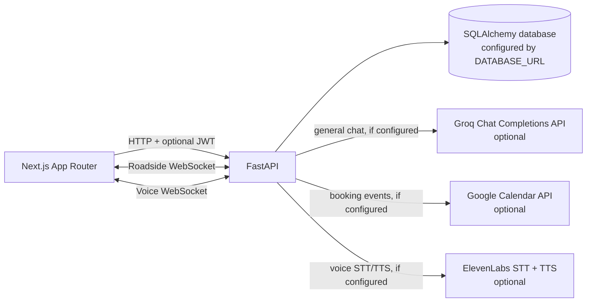

Here is the complete `HANDOFF.md` in one block. Paste it as-is.

```markdown
# Car Assistance — Developer Handoff
**Repository:** `thisismaryam/Car-Assistance`
**Scope:** Current source tree and tracked project files. Local `.env` values are intentionally not reproduced here.

> This document describes the code as it exists, including known setup, migration, and authorization gaps. Treat the items in **Known issues** as unresolved until verified in source and fixed.

## Contents

1. [Project at a glance](#1-project-at-a-glance)
2. [Architecture](#2-architecture)
3. [Repository map](#3-repository-map)
4. [Technology and runtime](#4-technology-and-runtime)
5. [Configuration and setup](#5-configuration-and-setup)
6. [Database and migrations](#6-database-and-migrations)
7. [HTTP API](#7-http-api)
8. [Business behavior](#8-business-behavior)
9. [Frontend routes](#9-frontend-routes)
10. [AI assistant](#10-ai-assistant)
11. [Voice assistant](#11-voice-assistant)
12. [Roadside real-time updates](#12-roadside-real-time-updates)
13. [Email and Google Calendar](#13-email-and-google-calendar)
14. [Tests and checks](#14-tests-and-checks)
15. [Known issues and operational risks](#15-known-issues-and-operational-risks)

---

## 1. Project at a glance

Car Assistance is a Next.js frontend and FastAPI backend for workshop appointments, at-home service bookings, customer vehicles, and roadside dispatch.

Current product flows:

- Workshop and home-service bookings can be submitted as a guest. The backend creates or reuses a customer record from the submitted email and can create or associate a vehicle.
- Account holders can view their garage and booking history. Guest bookings can also be looked up through the chat assistant by email and phone; there is no standalone lookup page.
- Roadside requests require an authenticated account and support status updates, mechanic assignment, and browser tracking.
- Admins manage bookings, mechanics, services, and roadside requests in the operations UI.
- The chat assistant uses a Groq LLM for general responses when configured, with deterministic database/RAG fallback behavior. A voice mode (ElevenLabs STT + TTS) drives the same orchestrator.

The backend uses synchronous SQLAlchemy sessions and synchronous FastAPI handlers in most routes.

## 2. Architecture



The backend app and route mounts are in [backend/app/main.py](./backend/app/main.py). SQLAlchemy engine/session setup is in [backend/app/database.py](./backend/app/database.py). Frontend pages call the backend directly; there is no shared frontend API client or server-side proxy.

## 3. Repository map

```text
backend/
  app/
    api/endpoints/       FastAPI routers: auth, bookings, chat, mechanics,
                         roadside, services, vehicles, voice
    core/                Settings, JWT/password helpers, rate limiter
    knowledge/           Approved text corpus used by RAG fallback
    models/              SQLAlchemy models
    schemas/             Pydantic request/response models
    services/            Availability and roadside dispatch
      ai/                Chat orchestrator, RAG retriever, DB tools
    utils/               Email and Google Calendar helpers
  alembic/versions/      Versioned database migrations
  scripts/               Google Calendar auth helper
  tests/                 unittest suite
    test_chat_guest.py   Guest booking lookup through the assistant
    test_voice.py        ElevenLabs voice endpoint (faked)
  seed_mechanics.py
  seed_services.py
  requirements.txt

frontend/
  src/app/               Next.js App Router pages and layouts
  src/components/        ChatWidget, SiteChrome, VehicleForm,
                         useVoiceChat (voice session hook)
  public/                pcm-capture-worklet.js (mic capture worklet,
                         served statically)
  package.json
  package-lock.json
  next.config.ts

HANDOFF.md
```

The checked-in frontend also has `frontend/AGENTS.md` and a default Next.js `frontend/README.md`. The local backend virtual environment and `backend/.env` are not tracked; `backend/.gitignore` excludes `.venv/` and `.env`.

## 4. Technology and runtime

| Area | Current implementation |
|---|---|
| Backend | Python 3.14.3 in the inspected local virtual environment; FastAPI |
| Database access | SQLAlchemy 2.x synchronous engine and `Session` |
| Database driver | `psycopg`; actual database URL comes from `DATABASE_URL` |
| Migrations | Alembic |
| Authentication | JWT (HS256), `python-jose`, bcrypt via Passlib |
| Validation/settings | Pydantic v2 and `pydantic-settings` |
| Frontend | Next.js 16.4.6 App Router, React 19.3.0, TypeScript |
| Styling | Tailwind CSS 4.3.3 plus global CSS |
| State | Page-local React state and `localStorage`; no shared state library |
| Realtime | Native WebSocket endpoints and browser `WebSocket` clients |
| Voice | ElevenLabs Scribe realtime STT + ElevenLabs TTS streaming; `httpx` for the TTS stream |

Pinned Python dependencies are listed in [backend/requirements.txt](./backend/requirements.txt). Frontend dependencies and scripts are in [frontend/package.json](./frontend/package.json).

## 5. Configuration and setup

### Backend settings

[backend/app/core/config.py](./backend/app/core/config.py) reads a `.env` file relative to the backend process working directory. `DATABASE_URL` and `SECRET_KEY` are required. The file is ignored by Git; do not copy credentials into this handoff or commit them.

| Variable | Use |
|---|---|
| `DATABASE_URL` | SQLAlchemy connection string; required |
| `SECRET_KEY` | JWT signing key; required and must be private/random |
| `APP_NAME` | FastAPI title; defaults to `Car Assistance API` |
| `DEBUG` | SQLAlchemy echo/debug setting; defaults to `True` |
| `GROQ_API_KEY` | Optional Groq API key; enables LLM responses |
| `GOOGLE_CLIENT_ID`, `GOOGLE_CLIENT_SECRET`, `GOOGLE_REFRESH_TOKEN` | Optional Google Calendar OAuth credentials |
| `GOOGLE_CALENDAR_ID` | Calendar target; defaults to `primary` |
| `ELEVENLABS_API_KEY` | Optional shared ElevenLabs key; used for both STT and TTS |
| `ELEVENLABS_STT_API_KEY` | Optional STT-only key; overrides the shared one |
| `ELEVENLABS_TTS_API_KEY` | Optional TTS-only key; overrides the shared one |
| `ELEVENLABS_VOICE_ID` | TTS voice; defaults to `JBFqnCBsd6RMkjVDRZzb` |
| `ELEVENLABS_TTS_MODEL` | TTS model; defaults to `eleven_flash_v2_5` |
| `VOICE_ALLOWED_ORIGINS` | WebSocket Origin allowlist; defaults to `http://localhost:3000,http://127.0.0.1:3000` |
| `SMTP_EMAIL`, `SMTP_PASSWORD` | Read by the email helper from process environment |
| `SMTP_HOST`, `SMTP_PORT` | Read by the email helper from process environment; defaults to Gmail SMTP and port 587 |

Voice is optional. Without any ElevenLabs key, `WS /api/voice/ws` closes with `"Voice is not configured on the server."` and text chat is unaffected.

**Configuration caveat:** SMTP fields exist on `Settings`, but [backend/app/utils/email.py](./backend/app/utils/email.py) reads them with `os.getenv()` instead of `settings`. Loading values through `pydantic-settings` alone does not populate `os.environ`; export the SMTP variables in the process environment or correct the implementation before relying on `.env` SMTP values.

### Windows development setup

Start PostgreSQL (or another SQLAlchemy-compatible database configured in `DATABASE_URL`) before running database-backed routes.

```powershell
Set-Location E:\CarAssistance\backend
python -m venv .venv
.\.venv\Scripts\Activate.ps1
pip install -r requirements.txt
```

Apply migrations only after reviewing the migration caveats in [Database and migrations](#6-database-and-migrations):

```powershell
Set-Location E:\CarAssistance\backend
.\.venv\Scripts\Activate.ps1
alembic upgrade head
```

Run the API from the backend directory so `.env` is found:

```powershell
Set-Location E:\CarAssistance\backend
.\.venv\Scripts\Activate.ps1
uvicorn app.main:app --reload --port 8000
```

Run the frontend in a second terminal:

```powershell
Set-Location E:\CarAssistance\frontend
npm ci
npm run dev
```

Frontend URL: `http://localhost:3000`
API docs: `http://localhost:8000/docs` and `http://localhost:8000/redoc`
Health endpoint: `http://localhost:8000/health` (returns `{"status":"ok"}`)

The frontend scripts are `dev`, `build`, `start`, and `lint`. There is no Docker Compose setup or checked-in CI workflow.

### Seed scripts

- `python seed_services.py` seeds a fixed service catalogue only when the services table is empty.
- `python seed_mechanics.py` creates sample mechanic accounts and schedules.

Run these only in a disposable/development database. The mechanic seed script contains fixed development passwords; do not use seeded accounts in production.

## 6. Database and migrations

Runtime models are under [backend/app/models/](./backend/app/models/). The main tables are:

| Table | Contents |
|---|---|
| `users` | Customer, admin, and mechanic accounts; roles are `customer`, `admin`, `mechanic` |
| `vehicles` | Owner, make/model/year, registration, optional notes |
| `services` | Name, description, type (`workshop`, `home`, `roadside`), price, duration, active flag |
| `bookings` | Customer, vehicle, service, optional mechanic, status, schedule, address/notes, optional `google_event_id` |
| `mechanic_schedules` | Weekly day-of-week and `HH:MM` working windows |
| `mechanic_time_offs` | Mechanic unavailability intervals |
| `roadside_requests` | User, optional vehicle, location, issue, lifecycle status/timestamps, optional assigned mechanic |
| `roadside_assignments` | Assignment history, mechanic, assigning admin, status, notes, timestamps |

Booking statuses in the model are `pending`, `confirmed`, `assigned`, `in_progress`, `completed`, and `cancelled`. Roadside status is stored as a string; code accepts both `en route` and `en_route`.

Alembic is configured in [backend/alembic.ini](./backend/alembic.ini); [backend/alembic/env.py](./backend/alembic/env.py) replaces the INI database URL with `settings.DATABASE_URL`. `app.main` does **not** create tables at startup.

### Migration state and blocker

`alembic heads` currently reports `c5e8a1d2f4b7` as the sole head. Do **not** assume `alembic upgrade head` works on a clean or partially migrated database:

1. `a3c49e710b12` adds `bookings.mechanic_id`; `b4d3e2f1a098` adds roadside assignment/lifecycle columns.
2. The later head revision `b4dfb1c8ebe8_restore_alembic_migrations.py` attempts to add those same columns and indexes again. Its upgrade is therefore likely to fail with duplicate-column/object errors after the earlier revisions have run. This was confirmed by comparing migration source; a database upgrade was not run during this audit.
3. The `c5e8a1d2f4b7_booking_google_event_id.py` revision is now discoverable by Alembic and adds `bookings.google_event_id` after `b4dfb1c8ebe8`. It has not been applied to any database as part of this work.

Resolve and test the migration chain on a disposable database before onboarding or production deployment. Do not repair migration history by blindly editing an already-applied revision on a shared database.

## 7. HTTP API

Base URL in current frontend code: `http://localhost:8000`. Authenticated requests use `Authorization: Bearer <token>`. Login is form-encoded (`username` is the email address).

### Authentication — `/auth`

| Method | Path | Access | Behavior |
|---|---|---|---|
| `POST` | `/auth/register` | Public | Creates a customer account |
| `POST` | `/auth/login` | Public | Returns a JWT; limited to 10 requests/minute per client IP |
| `GET` | `/auth/me` | Bearer | Returns the current user |

Registration is limited to 5 requests/minute per client IP. Token lifetime is seven days; HS256 and expiry are constants in [backend/app/core/security.py](./backend/app/core/security.py), not configurable settings.

### Services — `/services`

| Method | Path | Access | Behavior |
|---|---|---|---|
| `GET` | `/services/` | Public | Lists active services; optional `service_type` filter |
| `POST` | `/services/` | Admin | Creates a service |

There are no service update/delete routes in the current router.

### Vehicles — `/vehicles`

| Method | Path | Access | Behavior |
|---|---|---|---|
| `POST` | `/vehicles/` | Bearer | Adds a vehicle for the current user |
| `GET` | `/vehicles/my-vehicles` | Bearer | Lists the current user's vehicles |
| `DELETE` | `/vehicles/{vehicle_id}` | Bearer | Deletes an owned vehicle |

### Bookings — `/bookings`

| Method | Path | Access | Behavior |
|---|---|---|---|
| `GET` | `/bookings/availability?service_id=…&date=YYYY-MM-DD` | Public | Returns service/date metadata and a `slots` array |
| `POST` | `/bookings/` | Public / optional Bearer | Creates a booking; guest fields or an authenticated user's vehicle are required |
| `POST` | `/bookings/lookup` | Public | Looks up bookings using matching email and phone; limited to 10/minute |
| `GET` | `/bookings/my` | Bearer | Lists the current user's bookings |
| `GET` | `/bookings/all` | Admin | Lists all bookings |
| `GET` | `/bookings/{booking_id}` | Optional Bearer | Loads a booking with customer, vehicle, service, and mechanic details |
| `POST` | `/bookings/{booking_id}/view` | Public | Guest view; requires matching email **and** phone |
| `PATCH` | `/bookings/{booking_id}/assign` | Admin | Assigns/reassigns an available mechanic |
| `PATCH` | `/bookings/{booking_id}/cancel` | Bearer | Cancels an owned booking; admin can cancel any |
| `PATCH` | `/bookings/{booking_id}/status` | Admin | Sets the supplied status string and sends a confirmation email when set to `confirmed` |

Guest booking fields include customer name/email/phone and vehicle make/model/year/registration. Home service additionally requires an address. Roadside services are rejected by this endpoint and should use `/roadside/`.

### Roadside — `/roadside`

| Method | Path | Access | Behavior |
|---|---|---|---|
| `POST` | `/roadside/` | Bearer | Creates a request for the current user |
| `GET` | `/roadside/my` | Bearer | Lists the current user's requests |
| `GET` | `/roadside/all` | Admin | Lists all requests |
| `GET` | `/roadside/{request_id}` | Bearer | Owner or admin detail |
| `PATCH` | `/roadside/{request_id}/assign` | Admin | Assigns a mechanic/provider and records an assignment |
| `PATCH` | `/roadside/{request_id}/status` | Bearer | Admin may set lifecycle status; customer may only cancel their own request |
| `WS` | `/roadside/ws/admin` | **No authentication in current handler** | Admin event stream |
| `WS` | `/roadside/ws/customer/{request_id}` | **No authentication in current handler** | Request status stream |

### Mechanics — `/admin/mechanics` and `/mechanics`

The same router is mounted under both prefixes. All routes require **admin** access.

| Method | Suffix | Behavior |
|---|---|---|
| `GET` | `/` | Lists mechanics, schedules, and time off |
| `POST` | `/` | Creates mechanic and default Monday-Saturday 09:00-18:00 schedule |
| `PUT` | `/{mechanic_id}/schedule` | Replaces weekly schedule |
| `POST` | `/{mechanic_id}/time-off` | Adds a time-off interval |
| `DELETE` | `/{mechanic_id}/time-off/{time_off_id}` | Removes a time-off interval |
| `GET` | `/available-for-booking/{booking_id}` | Lists mechanics available for a booking |

### Chat, voice, and health

| Method | Path | Access | Behavior |
|---|---|---|---|
| `POST` | `/api/chat` or `/api/chat/` | Optional Bearer | Chat endpoint |
| `POST` | `/chat` or `/chat/` | Optional Bearer | Same chat router mounted at compatibility prefix |
| `WS` | `/api/voice/ws` | Optional Bearer (JWT in the `start` message; guests allowed) | Full voice session with barge-in |
| `GET` | `/health` | Public | Returns `{"status":"ok"}` |

Chat request fields are `message` and optional `history: [{role, content}]`. The response fields are `reply`, optional `branch`, `booking_id`, and `booking_link`.

## 8. Business behavior

### Booking validation

[backend/app/api/endpoints/bookings.py](./backend/app/api/endpoints/bookings.py) and [backend/app/services/availability.py](./backend/app/services/availability.py) implement the following:

- Slot windows are generated in UTC between 09:00 and 18:00, Monday-Saturday, using the service duration.
- A two-hour minimum lead time is enforced.
- Workshop capacity defaults to three concurrent bays.
- Home-service capacity depends on active mechanics, their weekly schedule, time off, and overlapping assigned bookings; a 30-minute travel buffer is used for home work.
- Cancelled bookings do not occupy capacity. Home bookings are assigned to a free mechanic at creation when one is available.
- Booking creation checks vehicle time conflicts, duplicate bookings, a maximum of five bookings per customer per day, and slot capacity.
- PostgreSQL advisory locking is attempted for booking creation, but the lock call is wrapped in a broad exception handler. Do not treat it as a guaranteed cross-database concurrency control.
- If a slot is unavailable, the service searches up to three days beginning at the requested date and returns at most five alternatives.
- Roadside service type is not bookable through the normal booking endpoint.

### Roadside lifecycle

Typical statuses are `requested`, `accepted`, `assigned`, `en route`/`en_route`, `arrived`, `resolved`, and `cancelled`. Status is a string, not a database enum. Admins can update the lifecycle; a customer can cancel only their own request.

### Guest booking and booking lookup

The booking create endpoint can create a customer using the submitted email and a random generated password, or reuse an existing user matching that email. The lookup endpoint requires both email and phone to match; it compares digits from the last ten phone-number digits. The API lookup is rate-limited; the standalone frontend lookup page does not exist, but the assistant exposes the same lookup (see [AI assistant](#10-ai-assistant)).

## 9. Frontend routes

The root layout renders [frontend/src/components/SiteChrome.tsx](./frontend/src/components/SiteChrome.tsx): public navigation, footer, and chat are hidden on `/admin/*`. `localStorage["token"]` is used for browser auth. The dashboard layout does not force login, so its workshop and home-service booking routes are guest-accessible.

| Route | Purpose and access |
|---|---|
| `/` | Public landing page |
| `/services` | Public service catalogue; loads from `GET /services/` |
| `/emergency` | Public page shell; submitting and tracking a roadside request requires login |
| `/login` | Staff sign-in page using `POST /auth/login` |
| `/admin/login` | Separate admin sign-in screen using the same API |
| `/dashboard` | Guest-capable workshop booking wizard |
| `/dashboard/home-service` | Guest-capable home-service booking wizard |
| `/dashboard/vehicles` | Authenticated garage list |
| `/dashboard/bookings` | Authenticated booking history |
| `/dashboard/bookings/[id]` | Booking detail page with cancellation action |
| `/admin` | Admin booking overview |
| `/admin/bookings` | Booking management and mechanic assignment |
| `/admin/mechanics` | Mechanic and time-off management |
| `/admin/services` | Service creation and catalogue |
| `/admin/roadside` | Roadside dispatch console |

The admin layout checks `/auth/me` and permits only role `admin`; mechanics do not have a separate frontend or mechanic-specific API authorization. The frontend garage currently only lists vehicles. `frontend/src/components/VehicleForm.tsx` exists but is not imported.

The booking detail page (`frontend/src/app/dashboard/bookings/[id]/page.tsx`) handles a stale/expired token: on `401` from `GET /bookings/{id}` it drops the token and falls back to `POST /bookings/{id}/view` using `guest_contact` in `sessionStorage` (set by the workshop/home-service wizards). The guest view requires matching email **and** phone.

Frontend API and WebSocket addresses are hardcoded to `localhost:8000` throughout the pages/components. CORS in `main.py` permits only `http://localhost:3000`. The voice WebSocket has a separate Origin allowlist (`VOICE_ALLOWED_ORIGINS`).

## 10. AI assistant

The chat implementation is in [backend/app/services/ai/orchestrator.py](./backend/app/services/ai/orchestrator.py), [backend/app/services/ai/rag.py](./backend/app/services/ai/rag.py), and [backend/app/services/ai/tools.py](./backend/app/services/ai/tools.py).

The orchestrator classifies booking, confirmation, pricing, availability, booking lookup, and general knowledge intents. Booking flows use backend validation and, for the conversational execution path, require an authenticated user with a vehicle in their garage, an eligible service, an available time, and explicit confirmation. Guests who ask the assistant to book are instead pointed at the [Workshop](/dashboard/workshop) and [At-home service](/dashboard/home-service) booking forms, where they can enter their details and vehicle without an account. Existing bookings can be looked up through the assistant by email and phone.

### Guest booking lookup through the assistant

The orchestrator has a `BOOKING_LOOKUP` branch (see [backend/app/services/ai/orchestrator.py](./backend/app/services/ai/orchestrator.py)) triggered by phrases such as "my appointment", "status of my booking", "booking #123", or as a follow-up when the assistant asks for email and phone.

- If email and phone are missing, the assistant asks for both.
- Email is matched case-insensitively; phone is compared on the **last 10 digits** — the same rule as `POST /bookings/lookup`.
- Mismatches are recorded; after **5 failures per email in a 15-minute window**, further attempts are throttled.
- On a match, the 5 most recent bookings are returned with a link to My Bookings.
- Authenticated users skip the identity step.

**Tests** — `backend/tests/test_chat_guest.py` (4 tests): lookup is not a login wall, matching email + phone returns the booking, wrong phone is throttled, and new-booking requests point guests at the booking forms.

### Model and fallback

For non-booking messages the orchestrator attempts a Groq Chat Completions request using model `openai/gpt-oss-120b` when `GROQ_API_KEY` is configured. This is a plain chat-completions request, not model tool-calling. If Groq is unavailable or unconfigured, deterministic fallback handlers use:

- Live service/pricing data from the `services` table.
- The availability engine for slot queries.
- The five approved documents in `backend/app/knowledge/approved_knowledge.py` for RAG-style knowledge responses.

The frontend chat widget sends `history`, displays the `branch` (including **🔎 Booking Lookup** for lookup responses), and renders a booking link when `booking_link` is returned. General user messages/history may be sent to Groq when configured.

## 11. Voice assistant

The chat widget has a microphone button that opens a voice session on `ws://localhost:8000/api/voice/ws`:

- Browser mic → PCM16 16 kHz binary frames → ElevenLabs Scribe realtime STT (WebSocket, VAD commit).
- Final transcript → the **same** `assistant_orchestrator` used by `POST /api/chat`.
- Reply text → ElevenLabs TTS HTTP stream (`pcm_24000`) → forwarded chunk-by-chunk to the browser and scheduled gaplessly for playback.

**Backend** — [backend/app/api/endpoints/voice.py](./backend/app/api/endpoints/voice.py):

- Mounted in [backend/app/main.py](./backend/app/main.py) at `/api/voice`.
- Keys: `ELEVENLABS_API_KEY` (shared), or `ELEVENLABS_STT_API_KEY` / `ELEVENLABS_TTS_API_KEY` (separate). Default voice `JBFqnCBsd6RMkjVDRZzb`, model `eleven_flash_v2_5`.
- WebSocket Origin is checked server-side (`VOICE_ALLOWED_ORIGINS`); browsers do not apply CORS to WebSockets. Bad origin → close 1008.
- Per-IP session cap and hard session time cap.
- Barge-in: if the user speaks while the assistant is talking, the TTS stream is cancelled and the browser flushes playback.
- Replies are cleaned for speech (markdown/links/emoji stripped, "Rs." → "Rupees") and trimmed.
- Auth: the browser sends the JWT in the `start` message; the server decodes it and checks the user exists/is active. **Guests may use voice** — `user_id` is `None`.
- New dependency: `httpx` (TTS stream).

**Frontend** — [frontend/src/components/useVoiceChat.ts](./frontend/src/components/useVoiceChat.ts), [frontend/public/pcm-capture-worklet.js](./frontend/public/pcm-capture-worklet.js), [frontend/src/components/ChatWidget.tsx](./frontend/src/components/ChatWidget.tsx):

- `useVoiceChat` manages `off | connecting | listening | thinking | speaking`, mic capture via AudioWorklet (downsamples to 16 kHz mono), gapless playback, and `start` / `stop` / `interrupt`.
- Chat widget adds the mic button, partial-transcript bubble, "Thinking…" indicator, voice status bar, and stops voice on close.

**Tests** — `backend/tests/test_voice.py` (3 tests): full turn streams audio byte-exact, bad origin rejected, long replies trimmed. Uses local fakes for ElevenLabs — no key or network required. Teardown can print a `ConnectionClosedError` traceback from the fake server; this is expected noise, not a failure.

## 12. Roadside real-time updates

[backend/app/services/roadside_dispatch.py](./backend/app/services/roadside_dispatch.py) stores admin sockets and per-request customer sockets in process memory. The roadside endpoint broadcasts `new_incident`, `incident_assigned`, and `incident_status_updated` events.

Current limitations:

- WebSocket handlers accept connections without validating a JWT, user role, or customer ownership. The customer socket path uses a request ID but does not check that the connecting user owns it.
- The admin socket does not send an initial snapshot on connect.
- Connections are process-local; there is no Redis/pub-sub broker or persistence.
- Frontend clients reconnect after a delay and use HTTP polling as a fallback.

## 13. Email and Google Calendar

### Email

[backend/app/utils/email.py](./backend/app/utils/email.py) sends SMTP mail when credentials are visible through `os.getenv()`. With no SMTP credentials it prints a simulated notification, including the body, to stdout.

Booking creation sends a receipt/confirmation-style email immediately, regardless of the initial `pending` versus `assigned` status. Changing a booking status to `confirmed` sends another confirmation email. SMTP errors do not roll back a booking.

### Google Calendar

[backend/app/utils/google_calendar.py](./backend/app/utils/google_calendar.py) optionally creates a calendar event for a booking, invites the customer, stores the event ID, and deletes the event on booking cancellation. Failures are best-effort and must not fail booking creation. Google API libraries are imported lazily.

Enable the Calendar API in Google Cloud, create an OAuth Desktop client, and set `GOOGLE_CLIENT_ID` and `GOOGLE_CLIENT_SECRET` in the backend environment. From the backend directory, run `python scripts/google_calendar_auth.py` and save its printed refresh token as `GOOGLE_REFRESH_TOKEN`; optionally set `GOOGLE_CALENDAR_ID` (defaults to `primary`). Keep the token private. Booking creation inserts an event with the customer as an attendee and `sendUpdates="all"`; booking cancellation deletes the event and sends the update. The API-backed availability calculation does not read external Google Calendar events, so this is event/invitation sync, not two-way calendar availability sync.

The migration for `google_event_id` is now discoverable as a `.py` revision, but it follows the migration chain blocker described in [Migration state and blocker](#migration-state-and-blocker). It has not been run against a database.

## 14. Tests and checks

The backend contains the in-memory SQLite suite at [backend/tests/test_features_4_5_6.py](./backend/tests/test_features_4_5_6.py), focused Google Calendar unit tests at [backend/tests/test_google_calendar.py](./backend/tests/test_google_calendar.py), guest chat lookup tests at [backend/tests/test_chat_guest.py](./backend/tests/test_chat_guest.py), and voice endpoint tests at [backend/tests/test_voice.py](./backend/tests/test_voice.py). The Google and voice tests mock the external providers and cover payloads, invitations, unconfigured operation, origin rejection, and long-reply trimming.

Run from the backend directory:

```powershell
.\.venv\Scripts\python.exe -m unittest discover -s tests -v
```

The backend suite passed during this work: **19 tests**. `test_voice.py` uses local fakes and can print a `ConnectionClosedError` traceback from the fake server on teardown; this is expected and the test still passes. Starlette also emits a one-line deprecation warning about `httpx`/`httpx2` in `testclient`.

Neither suite validates a real PostgreSQL migration, live SMTP/Groq/Google/ElevenLabs connectivity, or the complete frontend/API interaction.

Frontend commands from `frontend/`:

```powershell
npm run lint
npm run build
```

## 15. Known issues and operational risks

Prioritize these before production use:

1. **Alembic chain is unsafe as checked in.** `b4dfb1c8ebe8` re-adds columns already added by earlier revisions. The Google Calendar migration is discoverable now, but depends on that problematic revision. Validate/fix the revision graph on a disposable database first.
2. **Unauthenticated booking detail exposure (partially mitigated).** `GET /bookings/{booking_id}` still uses optional auth and applies an owner filter only when a non-admin user is authenticated, so with no token it is not restricted. The frontend now avoids calling it anonymously — on `401` it falls back to `POST /bookings/{id}/view`, which requires matching email **and** phone. The raw endpoint is still exposed if called directly; add a guest verification mechanism before exposing it publicly.
3. **Unauthenticated roadside WebSockets.** Both WebSocket handlers accept without JWT/role/ownership checks. The customer stream is addressable by request ID.
4. **Guest booking identity/vehicle association needs review.** Booking creation reuses a user based on submitted email and searches vehicles by registration globally; verify ownership and guest identity before treating this flow as account-safe.
5. **Dependency manifest is incomplete for current imports.** `slowapi` is imported during backend startup but is not listed in `backend/requirements.txt`. Confirm `httpx` is pinned there too.
6. **SMTP configuration mismatch.** Email reads environment variables with `os.getenv()` instead of `settings`; `.env` values loaded only by Pydantic settings may not be visible to the helper.
7. **Hardcoded development endpoints.** Frontend HTTP and WebSocket URLs target localhost; CORS is hardcoded to one frontend origin (voice uses its own `VOICE_ALLOWED_ORIGINS`).
8. **Rate limiting is narrow and process-local.** Only registration, login, booking lookup, and the guest chat lookup throttle have limits in the current code; the shared limiter uses remote IP and default in-memory storage.
9. **Staff roles are not fully represented in the UI.** The admin guard allows only admins. Mechanic accounts can be created/assigned but have no mechanic portal.
10. **Vehicle form is disconnected.** The `VehicleForm` component is unused and the My Garage page only lists vehicles.
11. **Guest booking lookup is chat-only.** There is no standalone frontend lookup page; the lookup path is only reachable through the assistant. No frontend registration page exists either (registration is API-only).
12. **No `.env.example`, Docker Compose, or CI workflow** is present in the tracked project files.
13. **Status and validation looseness.** Roadside status is a string with both `en route` and `en_route`; booking status updates accept a string rather than a constrained request enum.
14. **Voice depends on an external provider.** The voice endpoint requires ElevenLabs credentials and network access; without them it closes with "Voice is not configured." ElevenLabs STT/TTS errors are surfaced to the client as an error message with a text fallback, but a bad key or quota exhausts the session.
15. **`POST /bookings/{id}/view` shape unconfirmed.** It is referenced by the frontend 401 fallback and listed in Section 7, but its request/response contract was not verified in source during this update. Confirm before relying on it.

Do not treat this list as a complete security audit. Re-check source and configuration before deployment, and keep all credentials out of Git and this document.
```

**Quick sanity check before committing** — run this to confirm `POST /bookings/{id}/view` actually exists. If it returns nothing, delete the `/view` row in Section 7 and Finding 15:

```powershell
Select-String -Path app/api/endpoints/bookings.py -Pattern "view"
```